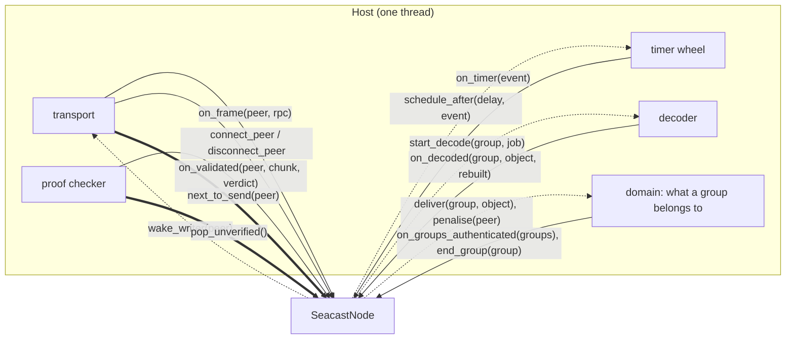
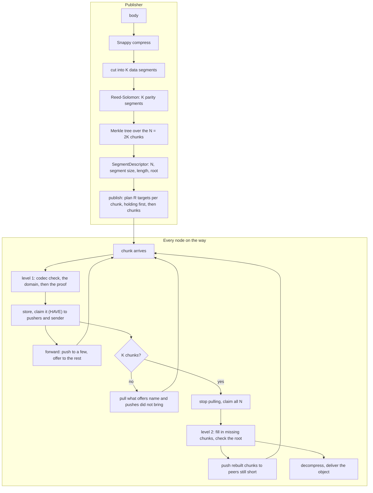
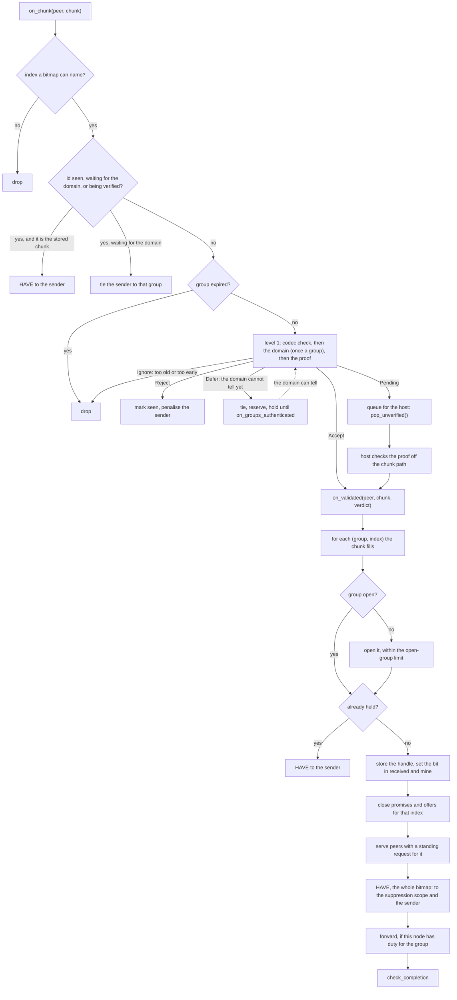
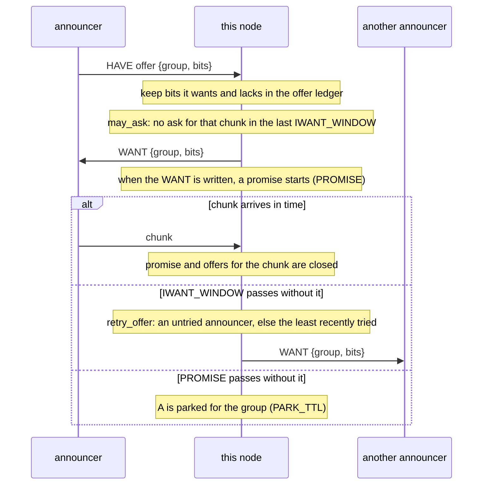
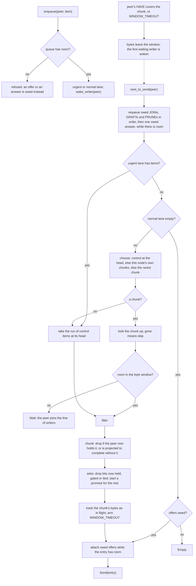
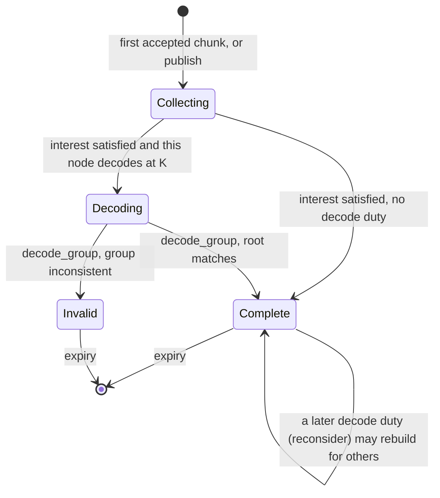
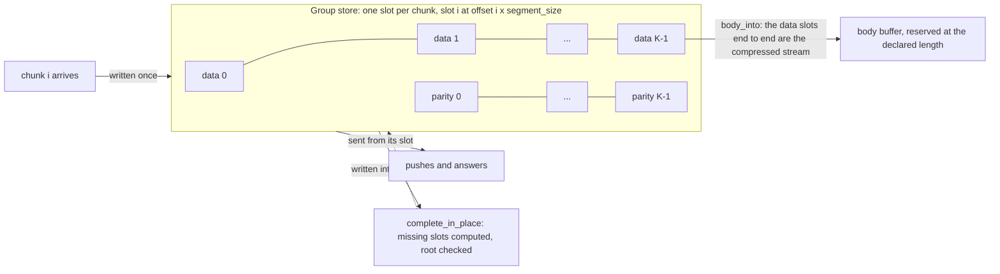

# `seacast-rs`

A Rust implementation of **SEACAST**: chunked, erasure-coded diffusion of large objects (the execution payload, data columns, rows) between peers. It follows `seacast.md` and the rules that document carries over from `seacast-lite.md`, from [Csaba Kiraly](https://www.github.com/cskiraly)'s `informed-diffusion-spec`  [repository](https://github.com/cskiraly/informed-diffusion-spec).

The protocol logic is a single-threaded state machine with no I/O. A host supplies the transport, the clock, the buffers and the domain's checks.

## Where this differs from the specification

This implements `seacast.md` of v0.12.0, with the rules it carries over from `seacast-lite.md`, and the gossipsub binding of `seacast-bindings.md` (§4) for the payload, in `seacast-gossipsub`. It differs from them as follows.

- **Only the gossipsub binding is implemented, for the payload, and without gossipsub's protobuf.** `seacast-gossipsub` has the control strings, the payload's chunk, group key and message id, and the hand-over of a received `RPC` in parts. A client's gossipsub reads and writes the `RPC` itself. The libp2p stream, Waggle, partial-messages and native QUIC bindings are not implemented. The strings and ids of cell groups are open in the specification, and the sampler's rules on gossipsub's wires (`seacast-bindings.md` §6) are not implemented: no chunk is admitted on a topic the host has not subscribed to.
- **The versions of the strings.** A holding and a WANT are written at version 4, an offer at version 1; the specification leaves open which version to write where every extra field has its default. A version 1 holding is read with `claim_all` and `complete` clear, where the specification reads them from a full bitmap. A version 1 `WantIndex` is read as a WANT with every extra field clear, which the specification leaves open.
- **The host keeps the mesh of a SEACAST topic.** With `TypeParams::host_relations` on, the node sends no GRAFT or PRUNE, ignores one received and runs no upkeep of relations: the client's gossipsub keeps the topic's mesh by its own rules and score, and tells the node of each change (`SeacastNode::relation_added`, `relation_removed`). The relation is then one colour, both ways. The floors, caps, colours and `MAX_RELATIONS` of `seacast.md` §4.1 do not apply to such a type; `relation_added` refuses only a peer that has not joined the type, or a relation the tables cannot keep.
- **A JOIN can be taken back** (`SeacastNode::on_leave`), which the specification has no message for: on gossipsub's wires a subscription is the JOIN, so an unsubscription ends the link for the type and its relations. Our own JOIN writes nothing on these wires: the host drops a `QueueEntry`'s `joins`, as its subscription has said it. What the peer told of the type's groups stays until they end.
- **A received `RPC` is handled in parts** (`SeacastNode::on_frame_part`, `seacast_gossipsub::Inbound`) where it holds more than one chunk or more than 16 of a message. The specification handles a frame's holdings after its asks, which the host keeps by putting the IDONTWANT entries last. An id asked twice in one frame is answered once only within a part; across parts the limit per id and peer (`gossip_retransmission`) holds.
- **An id a peer does not want is kept only for a group on record** (`SeacastNode::note_unwanted`), at most `max_unwanted_ids` per peer and heartbeat, and goes with its group. The specification keeps it with stock gossipsub's admission and lifetime.
- **A later chunk's block root is not shown to the domain.** The payload's group key binds the descriptor and the slot, not the block root (`seacast-lite.md` §1), and the node asks the domain once a group, with the first chunk's context. `seacast-lite.md` §3 looks up the installed block of every chunk. A host that must do so checks the root in its catalog's `check`.
- **Object types, their chunk layouts and what they belong to are the domain's.** The specification builds its object types into the protocol: the payload and the cell, their chunk layouts, and the block and slot they belong to. Here the core knows a chunk only by its type, group, index and an opaque frame. A type's chunk layout, its checks and how its groups are derived are its codec's (`TypeCodec`); what a group belongs to, whether it is authentic and when it ends are the domain's (`Domain`), and what the node takes part in is its policy's (`Policy`). This gives these differences:
  - **What a type sends with the first unsolicited chunk of a group on a link** is the type's: the node marks that write (`QueueEntry::first_of_group`, kept as a flag of the peer and group's pair record) and passes the mark to `TypeCodec::wire_size`, so the window counts it (`wire_size(p, entry)`). No type here sends anything with it. Where the pair record is gone, or the table is full, the next push is a first one again.
  - **The payload's formats are its codec's** (`seacast_gossipsub::PayloadCodec`), and are the specification's: the frame is the SSZ of `seacast-lite.md` §2's `Chunk` under design A, the group key `sha256(0x03 || group id || slot)`, the message id `group key || index || content id`, the content id the Altair message id over the topic and the frame. The node's id of the chunk is that id with the type and a zero group index, 59 bytes. The simulator's payload stays on the generic segmented codec below. `tests/prysm.rs` reads a coded group built by Prysm's code and rebuilds its frames byte for byte.
  - **The generic segmented codec** (`SegmentedCodec`) is not the specification's: its frame is `descriptor | context | proof | data`, its group key `sha256(0x03 || type || header id || context)` at index 0, and its id's content `sha256(leaf || descriptor || context || proof)`, `leaf` the digest of the data that level 1 checks the proof from, so the data is hashed once.
  - **Standalone types** are new: one chunk a group, no header and no proof, with the group's key `sha256(0x04 || type || frame)` and a level 1 that is that hash, index 0 and a length limit. The specification defines no type without a header.
  - **Level 1** is three steps where the specification has one `validate_chunk`: the codec's check of the chunk alone, the domain's answer on the group, then the proof. The domain is asked once a group and its answer is kept, so later chunks of an authentic group run only the codec's steps.
  - **The gate** is one call, `on_groups_authenticated`, where the specification has `on_block_installed` and `on_header_validated`.
  - **The live window** is a deadline the domain gives a group (`Domain::deadline`), a time on the host's clock, where the specification has the group's slot. A group and its deferred chunks go at the deadline at the latest, and its tombstone is kept until it. A group with no deadline has only the node's lifetimes: a deferred chunk goes `GROUP_TTL` after it arrived and a tombstone after `tombstone_ttl`.
  - **`FORWARD_LIMIT` is per period, not per slot.** The node has no slots. `SeacastNode::reset_period` starts a new period; a host with slots calls it at each slot boundary. The count is kept by `NodeId`, so connecting again does not reset it; the draft does not say. The counts are bounded by `max_peers`: with the table full, a request of a node without a count is not passed on. A host must therefore call `reset_period`.
  - **A stale tie is told by its sender's silence, not by a slot.** The draft drops a tie when the slot its sender's first copy named leaves the live window. Here a tie on a group with no state goes when its sender has not named the group for `group_ttl`.
  - **The scope of "one sample per peer" is the domain's.** The draft keys `sampled_from` by block. Here `Domain::sample_scope` maps a group to an opaque id, the group itself unless the domain says otherwise, and an entry lasts `group_ttl` from the ask.
  - **A peer of high custody is the policy's to tell** (`Policy::high_custody`): the base custody count is the domain's. The default knows only interest `ALL`.
- **The node opens no link: it reports what the floors are short of.** `keep_floor` and `keep_coverage` open links (§4.1). Here `SeacastNode::link_deficits` reports, per family, the links missing for the relation floor and for the floors `Policy::link_floors` states (repair, source, coverage), and the host opens them. A link counts once both JOINs are in and ours is queued, not from its opening, so the host subtracts the links it has opened and that are not joined yet. Which candidate to open, the draft's most families covered, is the host's.
- **Routing neighbours are not kept** (`ROUTE_FLOOR`, an option of the draft, off there). A routed request's step goes to a link with duty `FORWARD` drawn at random, as the specification does without them.
- **A custodian's alarm is not implemented** (`ALARM_WAIT`, with `ALARM_NEXT` and `ALARM_MAX`, an option of `seacast.md` §4.6 for networks without an honest supernode). A custodian that lacks a cell of a custody column sends no standing WANT for it to a row member.
- **The backoff after a PRUNE is kept only for a relation this node held or had asked for.** The specification records it for any PRUNE within `MAX_RELATIONS`; keeping it only for held or asked relations prevents a peer from filling `backoff` with unasked pairs.
- **At `SOURCE_OFFERS = PUBLISH` a source's offers are gathered, one a peer**, as `offer_at_publish` gathers a pull-only source's. The specification's `publish` sends one a chunk and peer; the bits offered are the same.
- **A claimant keeps at most `max_groups` probes while it decodes** (`probe_waiting`), the table shared by every asker. Full, a probe of a chunk not stored is dropped, as the draft did before it kept them, and the asker may judge an honest claimant.
- **Bitmaps are 1024 bits** (`BITMAP_WORDS` in `bitmap.rs`). `seacast-lite.md` allows 8192 indices in a plain group and a HAVE bitmap. 1024 chunks carry a 16 MiB body uncoded, which is past what consensus gossip lets one message be; a group or an index beyond it is refused. Every table, message and queue item that holds a bitmap grows with the constant, which is why it is not 8192.
- **A chunk whose compressed wire length is not set (`ChunkMsg::wire_len == 0`) counts its frame uncompressed in the window** (`chunk_wire_size`). `PayloadCodec::read_message` records the compressed length on receive, and a host that compresses a chunk once before sending may set `wire_len` so the window counts the compressed size. Gossipsub's protobuf around the message is not counted.
- **A HAVE or WANT with a bitmap longer than the node's** (128 bytes) is ignored without penalty. The binding's bound is 1024 bytes.
- **Level 2 may run away from the node.** The specification's `decode_group` decodes in place. Here `RuntimeEnv::start_decode` hands the host the chunks to decode and `SeacastNode::on_decoded` takes the result, so the decode may run on another thread; the chunks are those held when the decode was started. `SeacastNode::decode_group` does both on the node's thread.
- **A duplicate may be settled by its head.** The specification's `on_chunk` takes a whole chunk. `SeacastNode::on_chunk_head` lets a host that checks the proof itself drop a copy before reading its body: a copy of a chunk held is answered with a holding, and a copy of a chunk that waits for the domain ties its sender. Neither copy is verified, so a peer can be tied to, or told of, a chunk it sent only the head of. The copy that answers a probe is always read.
- **A GRAFT or PRUNE may be dropped where the specification never loses one.** A peer's owed relation messages are a ring of `max_queue_entries_per_peer`, with a place besides for the JOIN of each type, so a JOIN is never dropped. A GRAFT or PRUNE that repeats the last one owed for its family and colour takes no place. One refused by a full ring is dropped: a GRAFT of ours is then taken back, and upkeep makes it again.
- **Without `Policy::repair_to`, a rebuilt chunk goes to the peers of the push relation, and to a peer outside it only if its interest is not `ALL`.** The specification gives `REPAIR_TO` no default.
- **A descriptor's `encoding` goes with either `version`, and an uncoded body is compressed.** As Prysm's `seacast-devnet` has it: a plain group (`version = 1`) may carry `encoding = 1`, and a coded one `encoding = 0`. `build_group` compresses a body past the coded size and cuts the compressed bytes at `UNIT`; only where they have more segments than a group holds does the body go as it is. So a group's body decompresses to at most `MAX_PLAIN_BODY`, coded or not. A coded group still has `count = 2k`; Prysm reads any count above `k` up to 256, and Keccak-256, which are refused here.
- **A body longer than `MAX_PLAIN_BODY` is not built** (`build_group` panics): 1024 segments of `UNIT`, the bitmap's bound. The specification's plain group has up to 8192 chunks.
- **What is owed of a group of one chunk may be dropped.** The specification's `owed` keeps every offer a full queue refused. Here a peer's owed offers of groups of one chunk are a ring of `max_owed_single_per_peer`, and its owed answers another: full, the oldest goes. What is owed of the other groups is one table for all peers of `max_owed_pairs` pairs of peer and group, an equal share of it a peer: what is owed of a new pair beyond its peer's share is dropped, so one peer cannot take the room of what is owed to another.
- **State a peer can create** has limits the specification leaves open or does not name: `max_pairs` and `max_wide_pairs` on (peer, group) records.
- **The asks open at one peer are bounded** by `max_asks_per_peer`, and the ask records of the node by `max_ask_peers`. The specification bounds only the asks made of a peer within a heartbeat (`MAX_IHAVE_LENGTH`). An ask over a bound is not made: its group is taken up again at the next heartbeat, as for an offer over the IHAVE limits.

## Crates

| crate | what it is |
| --- | --- |
| `crates/seacast-core` | The state machine, `SeacastNode`: relations, chunk handling, push, pull, repair, the send window. No dependency but `fxhash`. |
| `crates/seacast-codec` | What a segmented object type needs: segmentation, Snappy, Reed-Solomon over GF(2^8) and, past 256 chunks, GF(2^16), SHA-256, the Merkle tree. |
| `crates/seacast-gossipsub` | The gossipsub binding: the control strings of IHAVE, IDONTWANT and IWANT (`is_seacast` tells them from a client's own entries), the payload's codec (its chunk, group key and message id; it reads a frame a host keeps cut at its data, `ChunkBytes::tail`) and catalog (`PayloadCatalog` over a `PayloadHost` that knows the blocks and over a codec, the payload's or a host's own built on it), a received `RPC` handed to the node in parts (`Inbound`) and a queue entry written to one (`write_entry`). No protobuf. |
| `crates/seacast-sim` | Everything specific to the domain: the type ids (payload, column, row), the payload type's catalog, and a discrete-event simulator that runs the five settings of `protocol-v2.md` §6.2 and checks the protocol's invariants. |

## The host's contract

`SeacastNode` never blocks, spawns nothing and holds no lock. Every entry point takes `&mut self`, so one thread owns a node and calls it from its own loop.



Solid arrows are calls into the node. Dotted arrows are `RuntimeEnv` callbacks: they only record what the host should do. The thick arrows are polled by the host. The node owns the send queues: `wake_writer` says a peer has something to write, and the host takes it with `next_to_send`.

A `PeerId` names a connection, not a node: the host may use it again once the connection has closed. Every peer id is below `CapacityConfig::max_peers`: the per-connection records are a slab indexed by peer id, and the node panics on an id out of range. Admission of a connection is therefore the host's. What the node gives out for a connection and takes back later carries a `GenerationPeerId`: the peer id with the count of its slot's connections in the high 32 bits. `pop_unverified` returns one, `on_validated` takes it, and `TimerEvent::Resample` holds one. The host passes it back unchanged and reads the peer with `peer_id()`. A verdict or a timer for a connection that has closed is dropped, though another connection has its peer id. The node takes the connection's `NodeId` from `Policy::node_id` at `connect_peer`, and the host allows one connection a node at a time. All state of a connection goes at `disconnect_peer`, except its parks, which are kept by `NodeId` until their end and return on the node's next connection. The count of routed requests passed on (`forwarded`) is by `NodeId` from the start.

Three steps may run on other threads, each as a request out and a result back in: the proof check (`pop_unverified`, `on_validated`), level 2 (`start_decode`, `on_decoded`) and the domain's word on a group (`Domain::authenticate` answers `Defer`, the host calls `on_groups_authenticated`). The node itself stays on one thread.

The traits a host implements, in `seacast_core::traits`:

| trait | role |
| --- | --- |
| `ChunkBuffer` | A handle to a chunk's bytes. The node stores, clones and compares handles and asks only `len()`. It never reads the bytes, so a handle may be a reference into a ring cache. |
| `RuntimeEnv` | Clock, timers, the writer's wake-up, the decode job, delivery, penalties. |
| `TypeCodec` | The networking mechanics of the object types: how a chunk's frame is laid out, its index count and threshold, the checks that need no outside knowledge, decode, projection onto groups. |
| `Domain` | What a group belongs to, whether that is authentic, and when its window closes. Asked once a group, with the id of the group's header and the chunk's context bytes. Called on the node's thread: a domain whose state lives elsewhere answers from a cache, and `Defer` on a miss. Also the scope within which no peer is asked for two samples (`sample_scope`). |
| `Policy` | What this node takes part in: its types, interest, duty and parameters (`TypeParams`), the link floors it keeps (`link_floors`), and which peers hold a family (`holds_family`) or are of high custody (`high_custody`). |
| `ObjectCatalog` | The three together: what the node is given. |
| `DeferredStore` | Reservations for chunks that wait for the domain's word on their group. |
| `RngSource` | Randomness. |

Two entry points are for a host that keeps links and has periods of its own:

- `SeacastNode::link_deficits(type, catalog, report)` reports each family in which the node has fewer links than a floor asks for, with the number missing. The host polls it, for example at its heartbeat, and opens the links. The floors are the relation floor (`F_LO` links per family with duty) and those of `Policy::link_floors`. `Policy::holds_family` says whether a peer's derived interest holds a family.
- `SeacastNode::reset_period()` starts a new period of the limits the specification counts per slot: at present the routed requests passed on per peer (`FORWARD_LIMIT`).

`NodeConfig::order_key` is a 32-byte secret the host draws at start. It orders the announcers beyond an ask's list by HMAC-SHA-256 (`protocol.md` §6.1).

## An object's life



A group is one object's chunks. Its id is known before any chunk of it exists, so peers exchange bitmaps about it and ask for it from the start.

The node knows nothing of blocks, slots or headers. A chunk is its type, its group, its index and a frame of bytes the node never reads:

```text
group     type u8 | key 32 bytes | index u16
index     u32
frame     header | context | proof | data     laid out by the type's codec
```

The group's index tells apart the groups under one key, the columns of a block say; a payload group has index 0. Every length in the frame follows from the type and the header, so no field carries one. A type may have no header, no context or no proof. The context is what the domain reads (for the payload, a slot and a block root); the codec only knows its length. A group's key binds the three: for a segmented type it is `sha256(0x03 || type || header id || context)`, and the header id is what the domain commits to.

## Receiving a chunk

The host hands the node a frame as an `Rpc`, or, where a gossipsub `RPC` holds more than an `Rpc` does, in parts (`on_frame_part`, built by `seacast_gossipsub::Inbound`). `on_frame` handles an RPC's parts in a fixed order: joins, the chunk, offers, asks, grafts, prunes, holdings, then one combined response. A GRAFT's answer is not part of that response: it goes through `SendQueues::send_relation`, as every JOIN, GRAFT and PRUNE does, which owes it at a full queue and keeps the connection's relation messages in order. A message for an object type the peer has not joined on the link is ignored. An IDONTWANT entry that is no holding and has a chunk id's length goes to `note_unwanted`.



A deferred chunk resumes when the host calls `on_groups_authenticated` with its group: for the payload when its block is installed, for a cell group when its header is validated, which may be earlier. The domain is asked once a group; later chunks of an authentic group need only the codec's checks.

Nothing is stored, claimed or forwarded before level 1 passes. Level 1 has three parts, in the order of their cost. `TypeCodec::check` needs only the chunk: the group id is that of its type, header and context, the index is one the header has, the length is what the header says. `Domain::authenticate` says whether the context commits that header. `TypeCodec::check_proof` reads the data (a Merkle path, a KZG proof); it may answer `Pending`, and the host then checks it and reports through `on_validated`.

`forward` works per group the chunk fills: its candidates are the push relation's peers for the chunk's colour that do not hold it and want it. It pushes to `R_NODE` minus the known holders, chosen furthest-behind first, and offers the chunk to the rest.

## Pulling what did not arrive

An offer (a HAVE with `offer = true`) says "you may ask me for these". The node asks one peer at a time per chunk.



Asks for one offer leave as the bits of one WANT, so none is left behind however many indices it names. When every announcer of a chunk is parked, a last-resort timer asks one of them again, with a doubling wait. Nothing is asked for before its group can be authenticated.

A sampler asks without an offer (`SeacastNode::sample`, `protocol-v2.md` §4.9). Each index goes in a WANT of its own, and no peer is asked for two samples of one scope. The first ask goes to a link whose interest holds the index, else as a routed request (`hops = ROUTE_HOPS`) to a forwarding link. After `SAMPLE_RETRY` without the chunk the peer is parked and another is asked, peers of high custody last, each waiting `SAMPLE_RETRY2`, with at most `SAMPLE_OUTSTANDING` asks of a scope in flight; the rest are held. When nobody is left the host is told through `RuntimeEnv::unreachable`.

A node with duty that cannot serve a routed request passes it one step on, to a link that serves the index, at most `FORWARD_LIMIT` times per asking peer and period. Beyond the limit it is silent. The answer returns through the standing ask.

## Sending

The node queues what it sends (`SeacastNode::sends`, a `SendQueues`): the queue and window of `protocol-v2.md` §4.11 and §4.12. A queued item is small: a chunk's key `(group, index)` or one control message. Each peer has a queue with two lanes: urgent (holdings, joins) and normal (chunks, offers, asks, relation control). `RuntimeEnv::wake_writer(peer)` tells the host that a peer has something to write; the host then calls `SeacastNode::next_to_send(peer)` until it gives nothing. The entry that goes on the wire is built when it is taken, so what is no longer to be sent is dropped then and an ask's promise starts then.



`next_to_send` returns `Send(entry)`, `Wait` or `Empty`. An entry carries at most one chunk, whose frame is one buffer handle, plus control messages. An unsolicited chunk that is the first of its group written to the peer is marked (`QueueEntry::first_of_group`), so that its type may send more with it. The window is in bytes and node-wide; control takes no room in it. A writer whose transport write has not completed (`RuntimeEnv::is_writing`) keeps its place in the waiter line while writers behind it may take room; when a writer in line starts waiting on its transport, the host calls `SeacastNode::write_waits` to wake the next writer that can write. Because the chunk is chosen at the moment of sending, a host that polls keeps the late choice: while the window is full, items wait and the rarest goes first when room returns.

## Completion, decode and delivery



At K chunks the node stops pulling and claims all N before decoding: a group that fails level 2 fails at every node, so the claim can only be wrong about a group everyone drops. `RuntimeEnv::start_decode(group, job)` then hands the host the decode: the shape, and the handles of the chunks held. The job borrows the node's scratch, so the host copies the handles out before it returns. The host runs `TypeCodec::decode` on them, on any thread, and passes the object and the rebuilt chunks to `SeacastNode::on_decoded`. `on_decoded` stores the rebuilt chunks, fills the other groups a chunk belongs to, pushes rebuilt chunks to peers still short, and delivers. A host that decodes on the node's thread calls `decode_group` instead, which does all of it.

`SegmentedCodec` in `seacast-codec` is the `TypeCodec` of a segmented type: its trait `check_proof` answers `Pending`, and `SegmentedCodec::check_proof` is the Merkle check the host runs. `PayloadCatalog` in `seacast-sim` is the payload object type for a node: a `SegmentedCodec`, a `Domain` that asks its `PayloadHost`, and the node's policy. `crates/seacast-sim/tests/payload.rs` runs real groups through a node with it, with a host that plays the consensus side.

A host that keeps chunks in a slot store uses the codec's slice-level functions, which decode a group where its chunks already lie:



The code is systematic, so the K data slots are the Snappy stream itself. If every data chunk arrived, no Reed-Solomon runs. Otherwise only the missing slots are computed. Hashing follows the same rule: level 1 has already proved the leaf digest of every chunk that arrived, the host keeps it (32 bytes a chunk), and level 2 hashes only the chunks it computed before it rebuilds the tree's upper nodes and compares the root. The node's own decode does the same: the reader's `identify` (`ChunkLayout`, `SegmentedCodec`) leaves the data's leaf digest in the chunk's `memo`, a field of `ChunkMsg` the node carries and does not read, `SegmentedCodec::check_proof` checks the proof from it, and `decode_and_reencode` takes it for the K chunks it decodes from. A chunk's bytes therefore move twice: from the network into its slot, and from the slots into the decompressed body.

| function (`seacast-codec`) | what it does |
| --- | --- |
| `SegmentedCodec` | the `TypeCodec` of a segmented type, over the functions below |
| `build_group` | body to descriptor and shards, at the publisher |
| `group_id`, `group_key` | a descriptor's id, which the domain commits; a group from its type, that id and its context |
| `split_frame`, `build_frame`, `build_chunks` | a segmented chunk's frame taken apart and put together; a group's chunks as a publisher hands them to the node |
| `check_frame`, `check_frame_proof`, `frame_leaf_hash` | level 1 for one chunk: descriptor, group id, index and length; then the Merkle proof. `frame_leaf_hash` is the proof check that returns the leaf digest it proved |
| `chunk_id` | a chunk's id: its group, its index and 20 bytes of a content digest that binds its whole frame |
| `ChunkLayout` | a type's frame layout, and level 1 in the two steps a stream reader takes: `check_head` on the bytes before the proof, `check_body` on the whole frame from the digest `identity` gave; `identify` sets a chunk's id and `memo` |
| `frame_identity`, `frame_content`, `check_frame_leaf` | a segmented chunk's id content and data leaf, hashing the data once; the proof checked from that leaf |
| `standalone_group`, `check_standalone` | a type with one chunk a group and no header or proof: its group id is the hash of its frame |
| `complete_in_place` | level 2 on a slot store: fill in what is missing, hash it, check the root with the digests level 1 proved for the rest, return the tree for proofs |
| `body_len`, `body_into` | the object's length, and its bytes written into a caller's buffer |
| `decode_and_reencode_with` | level 2 for any frame layout whose data is the frame's tail: the payload's codec uses it |

`build_group` and `decode_and_reencode` are the versions for hosts that keep each chunk in memory of its own (`Vec<u8>`, `Arc<[u8]>`).

## A group's lifetime

A group's state lives `GROUP_TTL` after its last chunk or its completion. The domain may give a group a deadline (`Domain::deadline`, asked with `authenticate` on the group's first chunk): the time its window closes, a slot boundary say. The group then goes at the deadline if that is sooner, and the host may end any group at once with `end_group`. When a group goes, one record is removed, with the pull state that named the group, and a tombstone keeps the group from being taken up again: until its deadline, or for `tombstone_ttl` if it has none. A deferred chunk goes at its group's deadline, or `GROUP_TTL` after it arrived. From the deadline on the domain answers `Ignore` for the group, as it does for one that is too early. A group known only from offers has no deadline until its first chunk.

## State

| kept per | where | holds |
| --- | --- | --- |
| group | `groups: Groups`, one `Group` record | type, header, state, the received, rebuilt and held bitmaps, interest, timestamps, probe and repair sampling |
| chunk | `chunks`, `known_id` | the handle and id |
| chunk | `holders`, `standing`, `asked_parked` | who holds it, who asked for it ahead of its arrival, who was asked for it while parked: a bitmask of peers each |
| group | `claims` | the peers that claim it whole, a bitmask |
| chunk, and peer and group | `probe_waiting`, `probe_waiting_of` | as a claimant still decoding, the askers whose probe waits for the chunk, a bitmask; the index each asker's probe of the group names |
| ask | `offers`, `asked_at` | announcers in order, when it was last asked |
| ask and peer | `tried`, `promises` | when the peer was asked, its running promise: one flat map each, with a bitmask of peers an ask, bounded by `max_ask_peers` in all and `max_asks_per_peer` a peer |
| peer and group | `pairs: Pairs`, one record a pair | what the peer holds, what was pushed and sent to it, whether a chunk of the group was pushed to it yet (`first_of_group`), its offers, its park; bitmaps of 128 bits in the record, wider ones in a pool |
| peer | `slots: PeerSlab<Peer>`, one record a connection, indexed by peer id | the connection's `NodeId`, the JOINs received and sent by type, the relation counts by type, the counts per peer of the limits; reset when the connection closes |
| peer | `sends.queue: PeerSlab<PeerQueue>`, indexed by peer id | the two lanes, the offers, answers and relation messages owed |
| type, family and colour | `push_in`, `push_out`: `Relations` | the peers of each direction of the push relation, a bitmask of `max_peers` bits a key |
| type | `linked` | the peers linked for the type (both JOINs in, ours queued), a bitmask |
| group | inside `pairs` | the peers with offers of the group and those with a holding of it, a bitmask each |
| peer and group | `named`, `wanted_groups`, `tied` | the groups a peer has named in HAVEs and offers, and in WANTs, the chunks tied to a root |
| node | `forwarded` | the routed requests passed on for it this period |
| node and group | `kept_parks` | the parks of a node without a connection, until their end |
| sample scope | `sampled_from`, `samples_in_flight`, `held_samples` | the peers asked for a sample, the asks in flight, the asks held back |

All tables are sized once, in `SeacastNode::new`, from `CapacityConfig`, and nothing allocates afterwards; a test in `crates/seacast-core/src/lib.rs` counts allocations to check it. Maps are fixed-capacity `FxHashMap`s.

A full table refuses a new key instead of failing, and state a peer can make the node keep is admitted against a limit first:

- groups without a header that a peer names: `max_pending_groups` per peer in HAVEs and offers, and as many again in WANTs, each WANT place for `GROUP_TTL` from the group's first naming;
- groups that are only named and groups that are open: `max_groups` each, counted apart, so naming groups cannot stop real ones from opening;
- relations on one link: `MAX_RELATIONS` (`TypeParams::max_relations`) pairs of family and colour per type, in any state: relations, GRAFTs not yet answered, backoffs not run out, GRAFTs and PRUNEs owed;
- answers to one peer: `SERVE_BUDGET` (`NodeConfig::max_served_per_heartbeat`) a heartbeat, besides answers on our own offers and to a claim's probe;
- ties to groups the domain cannot tell of yet: `max_pending_groups` per peer;
- routed sample requests passed on: `FORWARD_LIMIT` per asking peer and period.

## Building and running

```bash
cargo test                                         # unit, limit and simulation tests
just fmt                                           # rustfmt, on the pinned nightly
just clippy                                        # clippy, warnings denied
cargo run --release -p seacast-sim                 # the five settings of protocol-v2.md §6.2
cargo run --release -p seacast-codec --example bench   # timings of the codec's hot paths
```

`just clippy` does not lint the test and example targets: lint those with `cargo clippy --no-deps --all-targets -- -D warnings -A clippy::collapsible_if`.

The codec picks its SHA-256 and GF(2^8) kernels once, at first use, from the instructions the CPU reports: SHA-NI or the ARMv8 SHA2 instructions, a 16-lane AVX-512 SHA-256 for Merkle leaves with SHA-NI, or the ARMv8 instructions, on four leaves at a time for those that do not fill its batch, and GFNI with AVX-512, AVX2 or NEON for Reed-Solomon, each beside a portable arm. A build needs no `target-cpu` flag, and one binary runs on every CPU of its architecture. A kernel is compiled with the instructions it tests for and the rest of the code for the baseline of the target.

Parity is computed two ways, with the same bytes. The general one multiplies the data by the generator matrix: K products a parity byte. When K is a power of two the points `0..2K` are closed under XOR, and an additive FFT (Lin, Chung and Han) gives all K parity chunks in K log K products a byte column. `rs_parity_rows` takes it for a `(K, 2K)` code with such a K when enough parity rows are asked for; every other K, and a few missing rows, stay on the matrix. Recovery of missing data chunks is always by matrix; its coefficients are Lagrange basis values in closed form, so nothing is inverted. On the GFNI and NEON arms the matrix path computes up to eight output chunks in one pass over the inputs. On the arms other than GFNI it first copies each strip of the inputs side by side, since chunks kept end to end in one buffer evict each other from the cache.

## Layout of `seacast-core`

| module | contents |
| --- | --- |
| `node.rs` | `SeacastNode`: its tables, peer lifecycle, `on_frame`, `on_timer`, admission |
| `relations.rs` | joins and the coloured push relation: `on_join`, `on_graft`, `on_prune`, `maintain_relations`, `link_deficits` |
| `groups.rs` | chunk arrival, validation routing, deferral and ties, completion, decode, expiry |
| `push.rs` | holdings, `forward`, `choose_push`, `announce`, `publish` |
| `pull.rs` | offers, asks, promises, parking, serving |
| `repair.rs` | holdings from peers, claims and the probe, repair pushes, sampler pulls |
| `gossip.rs` | the heartbeat, gossip, heartbeat-counted lifetimes |
| `window.rs` | `enqueue` and the filter applied to an entry as it is taken to be written |
| `queue.rs` | `SendQueues`: the per-peer queue and the byte window; `next_to_send` |
| `state.rs` | `Peer`, `Relations`, `Group`, `Groups`, `Pairs`, `PeerQueue`, `AskPeers`, `GossipHistory` |
| `message.rs`, `types.rs`, `traits.rs` | messages, parameters, the host's traits |
| `bitmap.rs`, `collections.rs` | the bitmap, the fixed-capacity collections, `PeerSlab` and `PeerSets` |
